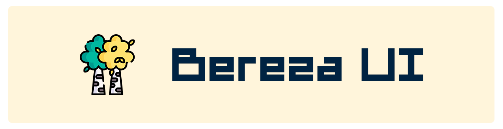

<p align="center">

</p>

<p align="center">
<strong>Дополнительные UI-компоненты для Compose
Multiplatform</strong><br> Bereza UI расширяет стандартный набор
Material 3 компонентами для создания современных и сложных интерфейсов.
</p>

<p align="center">


<a href="https://jitpack.io/#RavenZIP/bereza-ui">
  
</a>
</p>

<p align="center">
<a href="README.md">Русский</a> ·
<a href="docs/README-EN.md">English</a>
</p>

## ✨ О библиотеке

**Bereza UI** — библиотека UI-компонентов для Compose Multiplatform,
дополняющая стандартную Material 3 библиотеку элементами, которых может
не хватать при разработке приложения.

## 🧩 Компоненты

Ниже представлены наиболее интересные группы компонентов, на которые стоит обратить внимание.
Полный список лучше смотреть в коде проекта. В будущем будет вынесено в отдельную документацию.

- **Выбор из списка** — `Select`, `MultiSelect`.
- **Автодополнение и поиск** — `AutocompleteTextField`, `MultiAutocomplete`.
- **Группы переключателей** — `CheckBoxGroup`, `RadioGroup`, `SwitchGroup`.
- **Контейнеры** — `ExpandableCard`.

## 🌍 Поддерживаемые платформы

| Платформа | Статус               |
|-----------|----------------------|
| Windows   | ✅ Поддерживается    |
| Linux     | ❓ Неизвестно        |
| macOS     | ❓ Неизвестно        |
| Web       | ✅ Поддерживается    |
| Android   | ✅ Поддерживается    |
| iOS       | ❌ Не поддерживается |

macOS, iOS временно не поддерживаются, так как невозможно проверить работоспособность библиотеки на данных платформах.

## 🚀 Установка

### 1. Добавьте JitPack репозиторий

**settings.gradle.kts**

```
dependencyResolutionManagement {
    repositoriesMode.set(RepositoriesMode.FAIL_ON_PROJECT_REPOS)
    repositories {
        ...
        maven ("https://jitpack.io")
    }
}
```

### 2. Добавьте зависимость

Замените `$version` на версию, которую вы хотите использовать —
её можно найти на [JitPack](https://jitpack.io/#RavenZIP/bereza-ui).

**build.gradle.kts**

```
dependencies {
    implementation("com.github.RavenZIP.bereza-ui:bereza-core:$version") 
}
```

Если вы используете libs.versions.toml

**libs.versions.toml**

```
[versions]
ravenzip-bereza-ui = "$version"

[libraries]
ravenzip-bereza-ui-core = { module = "com.github.RavenZIP.bereza-ui:bereza-core", version.ref = "ravenzip-bereza-ui" }
```

**build.gradle.kts**

```
dependencies {
    implementation(libs.ravenzip.bereza.ui.core)
}
```

## 🔗 Интеграции

[Kotlin Reactive Forms](https://github.com/RavenZIP/kotlin-reactive-forms) -
библиотека реактивного управления состоянием форм,
предоставляющая интеграцию с UI-компонентами через `FormControl`.

## 🗂️ Структура проекта

- **`bereza-core`** — основной модуль библиотеки с UI-компонентами.
- **`berezaApp`** — демонстрационное приложение.
- **`docs`** — документация проекта.
- **`images`** — изображения для README и документации.

## 🗺️ Планы развития

### ✨ Новые компоненты

- [ ] Кнопка с дополнительными действиями (`Split Button`)
- [ ] Поле ввода с отдельными ячейками для символов (`SegmentedTextField`)
- [ ] Поле ввода адреса (`AddressField`)
- [ ] Группа чекбоксов, с общим переключателем выбора всех элементов (`CheckboxTreeGroup`)

### ⚙️ Улучшения

- [ ] Оптимизация
- [ ] Решение TODO
- [ ] Документация и примеры использования

> Список планов предварительный и может меняться по мере развития проекта.

## 📜 Лицензия

Эта библиотека распространяется по лицензии Apache 2.0. Подробности смотрите в файле [ЛИЦЕНЗИЯ](LICENSE).

## 👾 Разработчик

**Черных Александр**

- [Telegram](https://t.me/RavenZIP)
